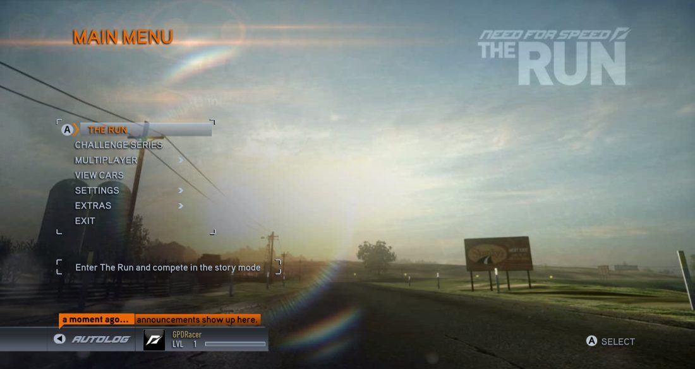
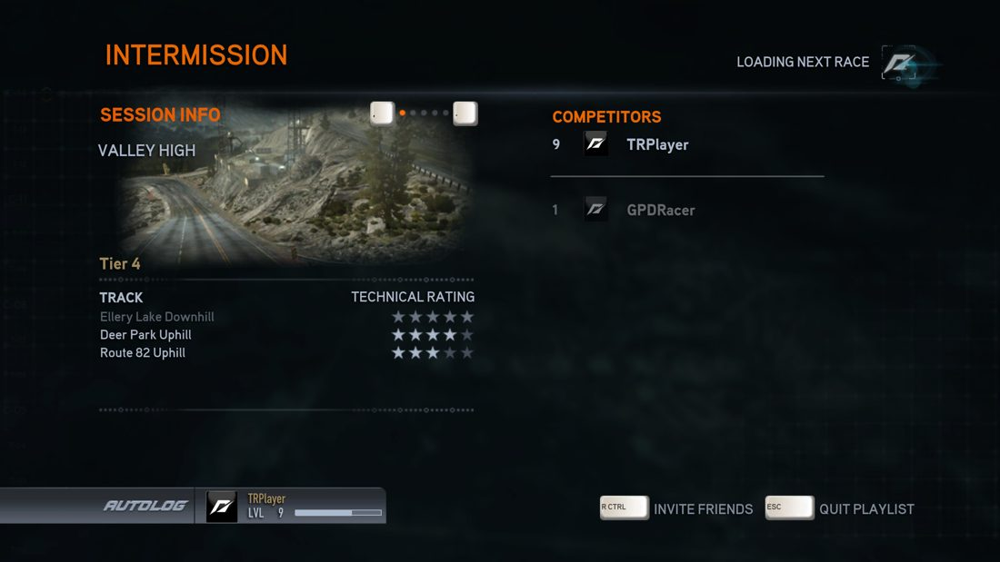
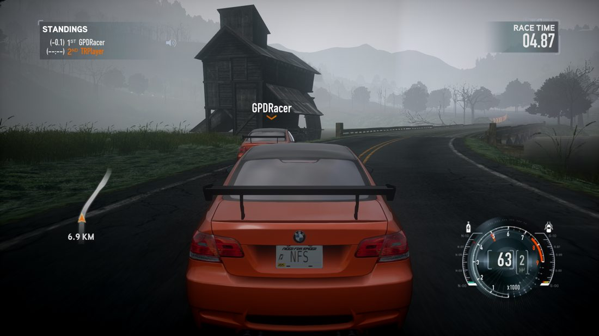
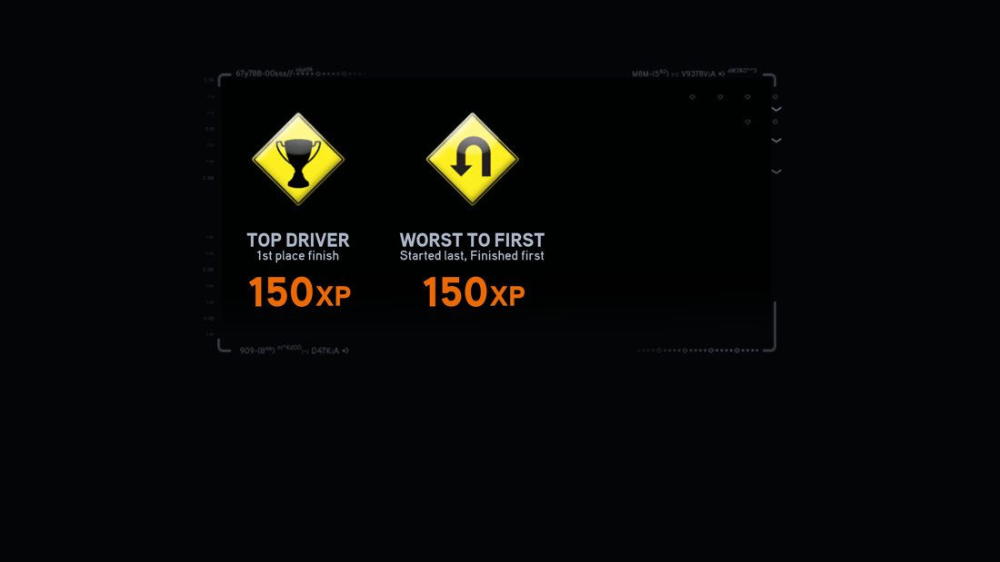

# NFSTR Online

Play **Need for Speed: The Run** multiplayer again - with friends on your network, over a VPN, or on a public server.
You need your own copy of the game (version 1.1.0.0). No game files are included.

 
 

## Play with friends (easiest way)

One of you is the **host**. Everyone else just joins.

**Everyone (host and players), 3 steps:**
1. Make a backup copy of your game folder.
2. Download `NFSTR_Online.zip` from the releases and extract it **into the game folder** (next to `Need For Speed The Run.exe`). One zip has everything.
3. Open `Scripts/NFSTR_Online.ini` in a text editor and set
   - `Host=` the host's address (see below),
   - `Name=` your player name (letters and numbers; pick a unique one).

**Start the game.** Windows: run the game as usual. Linux: run `./NFSTR_Online_Play.sh` in the game folder.
At the title screen wait about 20 seconds, press Enter, then choose **Multiplayer > Quick Match**.

**The host's address**
- Same home network: the host's local IP (for example `<ip>`).
- Friends far away: install a free VPN such as **Tailscale** or ZeroTier on every PC. The address is the host's VPN IP.
- A public server: its name or IP.

## Host a server

You already have everything: the same zip, extracted in your game folder, includes the server. Hosting needs [Python 3](https://www.python.org/downloads/)
(Windows: tick "Add Python to PATH").

- **Windows (experimental):** double-click **`StartServer.bat`**. It opens a window that shows what the server is doing, asks one thing (the address friends will use),
  and starts everything. Close the window or press Ctrl+C to stop. `AdminConsole.bat` opens the control panel (players, kick/ban, announcements, game mode).
- **Linux:** `./StartServer.sh <address> [modes]` in the game folder (uses `umu-run` if you have it, otherwise `wine` + `xvfb`). Stop: `./StartServer.sh stop`.
- **Stopping:** Windows: close the console window (or Ctrl+C). Linux: `./StartServer.sh stop`. The game's own server restarts itself after every session, so closing just its window won't stop it.
- **Different folder?** Run `StartServer.bat "D:\Games\NFS The Run"`, or put a `server.ini` in `NFSTR_Server` with `[Server]` and `GameDir=`, `Address=`, `Modes=`.

Containers and machines without a screen: see `NFSTR_Server/docs/NOTES.md`.

## Game modes

Modes add scoring on top of normal races - points, bonuses, teams, knock-outs - and rotate every few races. Standings show in the in-game News.
`cannonball` `timeattack` `elimination` `halving` `teamcannonball` `teamrelay` `teamcaptain` `streak` `survivor` `rivals` `jackpot`
`underdog` `hare` `plague` `margin` `bounty` `stagerace` `reverse` `photofinish` `personalbest`. Use `vanilla` for the normal game.

## Good to know

- Tested on Arch Linux only. It works with two players; more players and internet play are untested.
- The plugin only changes the game while it runs; nothing is edited on disk. It points the game at your server, skips the game's
  certificate check, and answers the game's Origin check itself. Delete the added files to go back to the normal game.
- Another `dinput8.dll` in the folder (Special K, ReShade) can clash with ours - use a clean copy of the game.
- No accounts: a name is just a name. Hosts can ban people from the control panel.
- Not working? Read `Scripts/NFSTR_Online.log` in the game folder.

## More

`docs/NOTES.md` has the technical details. The older LAN mod (join with a code, no server) is in `NFSTR_Extras/LAN_mod`.

## Credits and license

Built on the community's work on the game's LAN mode: the **NFSTR LAN Script** by Hypercycle, And799 and mRally2 (the dedicated-server
start-up and the idea of playing online again). `dinput8.dll` is the [Ultimate ASI Loader](https://github.com/ThirteenAG/Ultimate-ASI-Loader)
by ThirteenAG (MIT). This is a fan project, not affiliated with Electronic Arts; game names belong to their owners. No license has been chosen yet.
