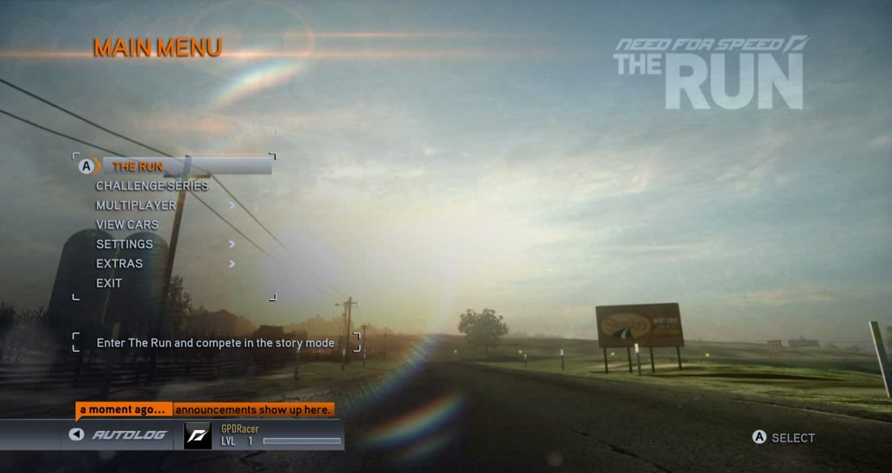
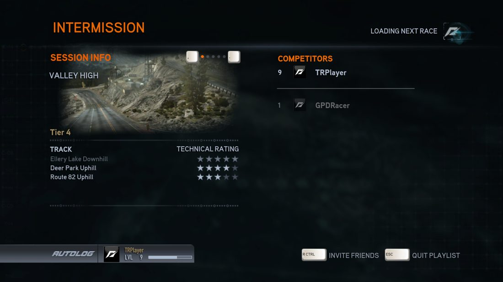
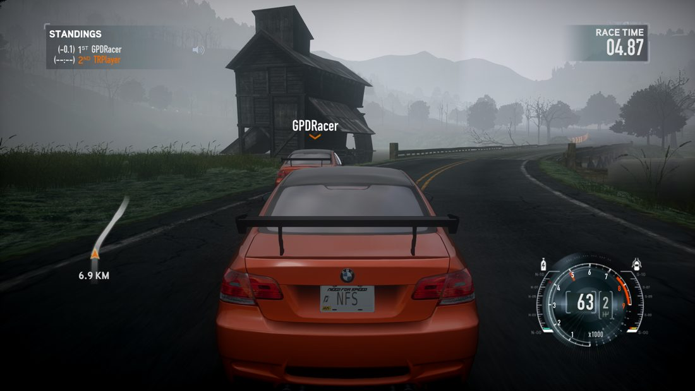
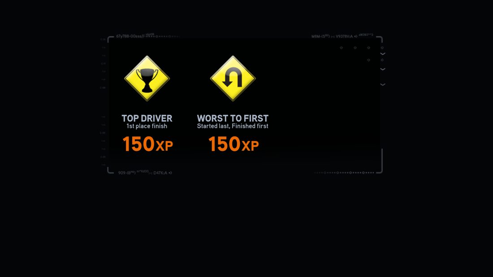

# NFSTR Online

Play **Need for Speed: The Run** multiplayer again - with friends on your network, over a VPN, or on a public server.
You need your own copy of the game (version 1.1.0.0). No game files are included.

 
 

## How to play

One of you is the **host**; everyone else joins. You need [Python 3](https://www.python.org/downloads/) installed (Windows: tick "Add Python to PATH").

1. Back up your game folder, then extract `NFSTR_Online.zip` from the releases **into the game folder** (next to `Need For Speed The Run.exe`).
2. Start it:

| | Windows | Linux |
|---|---|---|
| **Join** a friend | `NFSTR_Online_Play.bat` | `./NFSTR_Online_Play.sh` |
| **Host** a game (and play) | `NFSTR_Host_And_Play.bat` | `./NFSTR_Host_And_Play.sh` |

   The first time, it asks for the host's address and your player name.
3. In the game press Enter, then choose **Multiplayer > Quick Match**.

**The host's address:** on the same network, the host's local IP (the host's window shows it). Over the internet, install a free VPN such as Tailscale or ZeroTier on every PC and use the host's VPN address.

If the launcher says port 3216 is taken, close the EA app / Origin (also from the system tray) and start it again; the mod stands in for it.

Closing the game stops everything the launcher started. The server restarts itself after every race, so Windows may briefly minimize your game when it does. Playing in windowed mode avoids that.

## Hosting without playing

Run the server alone: `NFSTR_Server\StartServer.bat` (Windows) or `./NFSTR_Server/StartServer.sh [address] [modes]` (Linux, needs `umu-run` or `wine`; stop with `./NFSTR_Server/StartServer.sh stop`).
`NFSTR_Server\AdminConsole.bat` opens the control panel (players, kick/ban, announcements, game mode).
Machines without a screen and containers: see `NFSTR_Server/docs/NOTES.md`.

## Game modes

Modes add scoring on top of normal races - points, bonuses, teams, knock-outs - and rotate every few races. Standings show in the in-game News.
`cannonball` `timeattack` `elimination` `halving` `teamcannonball` `teamrelay` `teamcaptain` `streak` `survivor` `rivals` `jackpot`
`underdog` `hare` `plague` `margin` `bounty` `stagerace` `reverse` `photofinish` `personalbest`. Use `vanilla` for the normal game.

## Good to know

- Not working? Read `Scripts/NFSTR_Online.log` in the game folder.
- The mod only changes the game while it runs; nothing on disk is edited. To go back to the normal game, delete the files from the zip.
- Another `dinput8.dll` in the folder (Special K, ReShade) can clash with ours - use a clean copy of the game.
- No accounts: a name is just a name. Hosts can ban people from the control panel.
- Tested with a Linux host and Windows and Linux players. Windows hosting and internet play are newer and less tested.

## More

`docs/NOTES.md` has the technical details. The older LAN mod (join with a code, no server) is in `NFSTR_Extras/LAN_mod`.

## Credits and license

Built on the community's work on the game's LAN mode: the **NFSTR LAN Script** by Hypercycle, And799 and mRally2 (the dedicated-server
start-up and the idea of playing online again). `dinput8.dll` is the [Ultimate ASI Loader](https://github.com/ThirteenAG/Ultimate-ASI-Loader)
by ThirteenAG (MIT). This is a fan project, not affiliated with Electronic Arts; game names belong to their owners. No license has been chosen yet.
